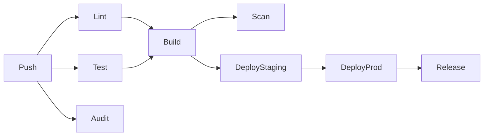

# 🌿 Contributing to AgriSense

Thank you for your interest in contributing to the AgriSense Smart Farming System! This guide outlines our development workflow, commit conventions, and branching strategy.

## Table of Contents

- [Git Workflow](#git-workflow)
- [Branching Strategy](#branching-strategy)
- [Commit Conventions](#commit-conventions)
- [Development Setup](#development-setup)
- [Pull Request Process](#pull-request-process)
- [Code Review](#code-review)
- [Release Process](#release-process)

## Git Workflow

We follow a **Git Flow**-inspired workflow with conventional commits.

### Branching Strategy

```
main          ─── Production-ready code (protected)
  │
  ├── develop ─── Integration branch (protected)
  │
  ├── feat/*  ─── New features (branched from develop)
  ├── fix/*   ─── Bug fixes (branched from develop)
  ├── chore/* ─── Maintenance tasks (branched from develop)
  ├── docs/*  ─── Documentation updates (branched from develop)
  │
  ├── release/* ── Release preparation (branched from develop)
  │
  └── hotfix/* ─── Urgent production fixes (branched from main)
```

### Branch Naming

- **Features:** `feat/short-description` (e.g., `feat/soil-moisture-map`)
- **Fixes:** `fix/short-description` (e.g., `fix/sfs-null-pointer`)
- **Chores:** `chore/short-description` (e.g., `chore/update-deps`)
- **Docs:** `docs/short-description` (e.g., `docs/api-readme`)
- **Releases:** `release/vX.Y.Z` (e.g., `release/v1.2.0`)
- **Hotfixes:** `hotfix/short-description` (e.g., `hotfix/auth-bypass`)

## Commit Conventions

All commits **must** follow the [Conventional Commits](https://www.conventionalcommits.org/) specification. This enables automatic changelog generation and semantic versioning.

### Format

```
<type>(<scope>): <subject>

<body>

<footer>
```

### Types

| Type       | Usage                                      | Release |
|------------|--------------------------------------------|---------|
| `feat`     | A new feature                              | minor   |
| `fix`      | A bug fix                                  | patch   |
| `docs`     | Documentation only                         | none    |
| `style`    | Formatting, missing semicolons, etc.       | none    |
| `refactor` | Code change that neither fixes nor adds    | none    |
| `perf`     | Performance improvement                    | patch   |
| `test`     | Adding or correcting tests                 | none    |
| `build`    | Build system or dependency changes         | none    |
| `ci`       | CI/CD configuration changes                | none    |
| `chore`    | Other changes (deps, tooling)              | none    |
| `revert`   | Reverting a previous commit                | depends |

### Scopes

- `api` — Node.js Express API
- `web` — React frontend
- `ml` — Python ML service
- `infra` — Docker, Nginx, Mosquitto, etc.
- `ci` — GitHub Actions workflows
- `deps` — Dependency updates
- `docs` — Documentation
- `db` — Database schema & migrations
- `scripts` — Utility scripts

### Examples

```
feat(api): add soil moisture threshold alerts

Implement real-time alerting when soil moisture drops below
configurable thresholds. Alerts are pushed via WebSocket and
persisted to the alerts table.

Closes #42
```

```
fix(ml): handle null GDD stage for cassava

Cassava has no predefined growth stage mapping, which caused
a null pointer in the stage lookup. Now falls back gracefully.

Fixes #87
```

```
chore(deps): bump express from 4.18.2 to 4.19.0
```

## Development Setup

### Prerequisites

- Docker + Docker Compose
- Node.js 20+
- Python 3.11+
- Git 2.30+

### First-time setup

```bash
# 1. Clone the repository
git clone git@github.com:thoth-codes/agrisense.git
cd agrisense

# 2. Copy environment file and fill in your keys
cp .env.example .env

# 3. Install Git hooks (enforces commit conventions)
make git-hooks

# 4. Install dependencies
make install

# 5. Start infrastructure (DB, Redis, MQTT)
make infra-up

# 6. Run database migrations
make db-migrate

# 7. Seed sample data
make db-seed

# 8. Start development
npm run dev
```

## Pull Request Process

1. **Create a feature branch** from `develop`:
   ```bash
   git checkout develop
   git pull
   git checkout -b feat/my-feature
   ```

2. **Make changes** with conventional commits:
   ```bash
   git commit -m "feat(api): add endpoint for soil health index"
   ```

3. **Keep your branch up to date**:
   ```bash
   git fetch origin
   git rebase origin/develop
   ```

4. **Run tests and linting** before pushing:
   ```bash
   make test
   make lint
   make typecheck
   ```

5. **Push and open a PR** against `develop`:
   ```bash
   git push -u origin feat/my-feature
   ```

   Use the [PR template](./.github/pull_request_template.md) — fill out all sections.

6. **Address review feedback** with additional commits.

7. **Squash and merge** once approved (maintain a clean history).

## Code Review

### Review checklist

- [ ] Does the code follow project conventions?
- [ ] Are there adequate tests covering the changes?
- [ ] Are edge cases and error states handled?
- [ ] Are secrets or credentials exposed anywhere?
- [ ] Does the change break existing functionality?
- [ ] Is documentation updated if needed?
- [ ] Are commit messages conventional?

### Reviewer expectations

- Review within 1-2 business days
- Be constructive and specific
- Approve only when all concerns are addressed
- Use GitHub's "Request Changes" for blocking issues

## Release Process

### Creating a release

1. **Create a release branch** from `develop`:
   ```bash
   git checkout develop
   git pull
   git checkout -b release/vX.Y.Z
   ```

2. **Bump version** and update changelog:
   ```bash
   # Update version in package.json and app package.json files
   make changelog
   ```

3. **Final testing** on the release branch.

4. **Merge to main** (via PR):
   ```bash
   git checkout main
   git merge --no-ff release/vX.Y.Z
   git tag vX.Y.Z
   git push origin main --tags
   ```

5. **Merge back to develop**:
   ```bash
   git checkout develop
   git merge --no-ff release/vX.Y.Z
   git push origin develop
   ```

6. **CI/CD automatically** builds Docker images, scans for vulnerabilities, deploys to production, and creates a GitHub Release.

### Hotfix process

For urgent production issues:

1. Branch from `main`: `git checkout -b hotfix/issue`
2. Fix, test, and commit
3. PR directly to `main`
4. After merge, cherry-pick the fix into `develop`

### Versioning

We follow [Semantic Versioning](https://semver.org/):

```
vMAJOR.MINOR.PATCH
```

- **MAJOR** — Breaking changes
- **MINOR** — New features (backward compatible)
- **PATCH** — Bug fixes (backward compatible)
- **Pre-release** — e.g., `v1.2.3-beta.1`

## CI/CD Pipeline

Our GitHub Actions pipeline runs automatically:



| Stage | Trigger | What happens |
|-------|---------|--------------|
| Secrets scan | Every push | Gitleaks checks for leaked credentials |
| CodeQL | Every push | GitHub's security analysis |
| Lint & Types | Every push | ESLint, flake8, bandit, TypeScript |
| Tests | Every push | Jest (API), pytest (ML) — matrix: Node 20/22, Python 3.11/3.12 |
| Dependency audit | Every push | npm audit, outdated check |
| Docker build | main, develop, tags | Multi-arch images pushed to GHCR |
| Vulnerability scan | main (after build) | Trivy scans production images |
| Deploy staging | develop | SSH deploy to staging environment |
| Deploy production | main, tags | SSH deploy to production environment |
| Release | tags | GitHub Release with auto-generated changelog |

## Questions?

Open a [GitHub Discussion](https://github.com/thoth-codes/agrisense/discussions) or reach out to the team.

---

*AgriSense Smart Farming System — Copyright (c) 2026 Ruai Tech Solutions. All rights reserved.*
